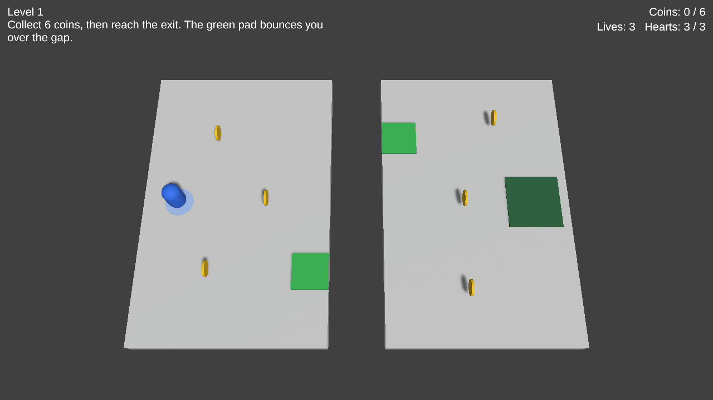
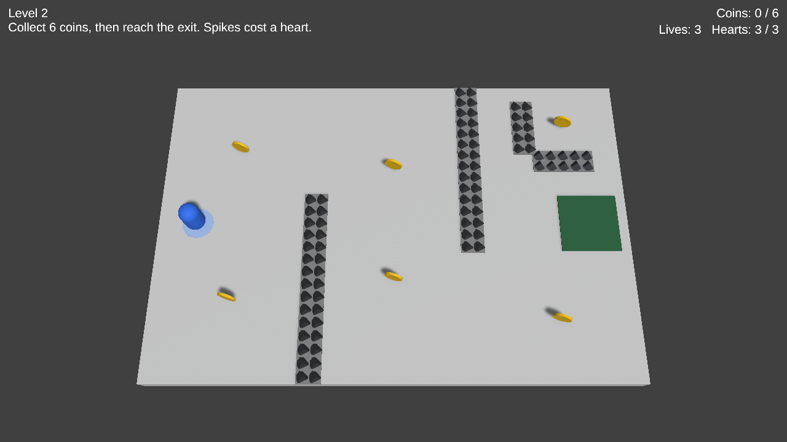
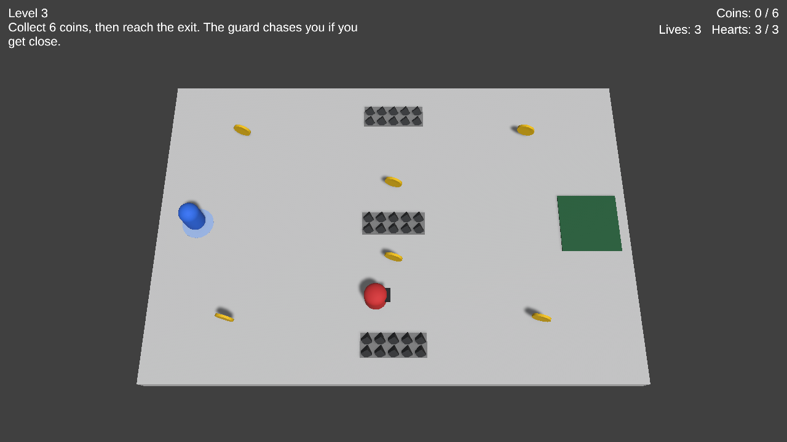
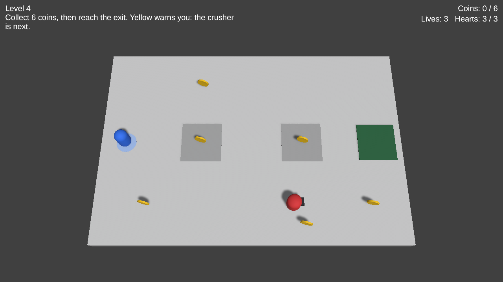
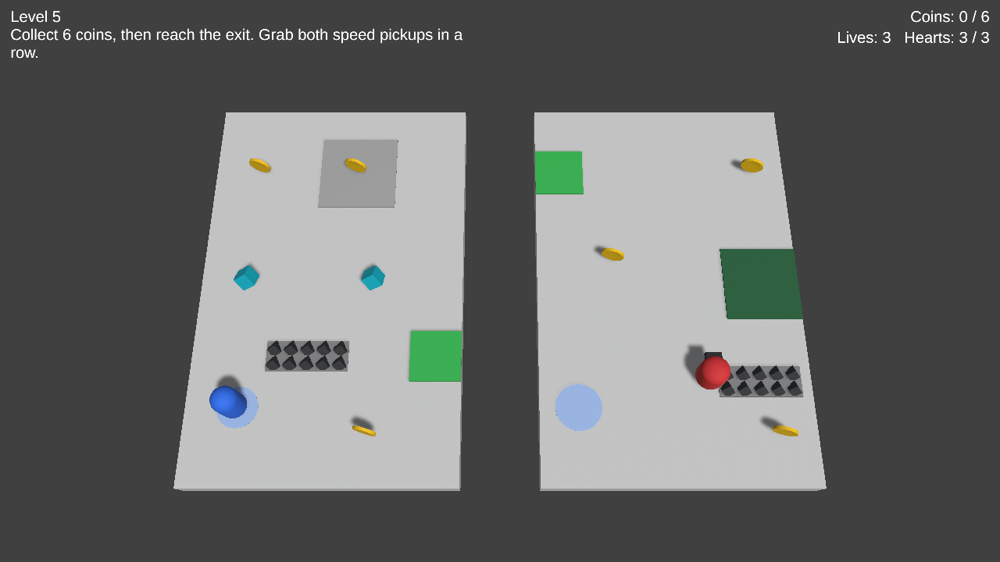

# CS464 Assignment 03 — Abdul Samad Sohail — BSSE23083

- **Video (60–120 s):** [\[DRIVE LINK\]](https://drive.google.com/file/d/180h8YzdN5ggwvEsqFgcgKiMuot98ZWWq/view?usp=sharing)
- **Started from:** [SIR ASKED US TO LEAVE THIS PART]
- **Controls:** WASD or the arrow keys. There's no jump, so if you need to get up and over something, the green pad does it for you.
- **To win a level:** grab all 6 coins. That unlocks the exit, and then you just walk into it.

## Levels

| Level | Screenshot | New idea | Combined with |
|---|---|---|---|
| Level01 |  | Coins, the exit, and a bounce pad to get across a gap | Nothing yet. Nothing here can hurt you, and you only lose a life if you fall off the edge. |
| Level02 |  | Spikes. Each touch costs one heart. | There's a coin hidden behind spikes right by the edge, so you have to think about whether it's worth it. |
| Level03 |  | A guard that walks its route, chases you if you get close, and then heads back | Spikes along its path, so if you panic and run the wrong way you'll still get hurt. |
| Level04 |  | The crusher. The first one is on its own, so you can stand back and watch the timing. | The second one has a guard walking around it. |
| Level05 |  | Two speed pickups, close enough that you can grab the second while the first is still going | Pretty much everything: the pad, spikes, a crusher and a guard going back and forth. I added a checkpoint too, since this level is a lot harder. |

## The numbers

| Number | Value | Why this value |
|---|---|---|
| Patrol speed | 2 m/s | The player tops out at around 8.3 m/s, so a patrolling guard is slow enough to watch for a second and work out a way past. |
| Chase speed | 3.5 m/s | Still way slower than the player. I wanted the guard to be scary, not impossible, so in the open you can always get away. |
| Chase range | 4 m | It only notices you if you get fairly close. On Level03 you spawn 7 m from its route, so it doesn't come after you as soon as the level starts. |
| Give-up range | 6 m | This is 2 m more than the chase range on purpose. When I imagined them being the same, the guard would just keep switching back and forth at that one distance. |
| Knockback | 6, ForceMode.Impulse, plus 0.25 s where you can't steer | Running into spikes at full speed pushed me back about 3 m in under a second. That's enough to actually see the hit and land clear of the spikes. |
| I-frames | 1 s | It gives you a moment to get out of there. Even if you keep walking into something, you only lose one heart a second. |
| Power-up duration | 5 s at 1.6x speed | On Level05 that's enough time to get to the second pickup, but not enough to blast through the whole level with it. |
| Crusher warning | 0.7 s, then it rests for 2.4 s | The minimum was 0.5 s. I went a little over so that if you're standing on it when it turns yellow, you can still get off in time. |
| Bounce pad | 9, ForceMode.VelocityChange | I started with 8 and a 4 m gap, and from a standstill the player didn't make it. With 9 and a 3 m gap you get across even without a run-up. |

## Short answers

**1. Why does a trigger need a Rigidbody on at least one of the two objects?**

Unity only checks for trigger events when at least one of the two objects has a Rigidbody. If neither does, nothing happens and you don't get any error, so it's easy to think your code is wrong. My coins, spikes and pads don't have one since the player's Rigidbody already covers it. The guard has its own kinematic Rigidbody because my script is the thing moving it.

**2. Which ForceMode do your knockback and your Part A force use, and why each?**

Knockback is Impulse, because it's one sudden push, and it only happens if TakeDamage actually returns true. Before pushing, PlayerController.Knockback wipes my sideways speed and stops steering for 0.25 s, so you get thrown the same distance whether you were running or standing. The bounce pad is VelocityChange from OnTriggerEnter, so it's a single kick each time you step on it, and it doesn't care about the player's mass.

**3. What does your code do when a second power-up is picked up while one is running?**

It refreshes the timer. BoostSpeed in PlayerController stops whatever boost coroutine is running and starts a fresh one, so you're back to a full 5 s and the speed doesn't stack on top. So two 5 s pickups 3 s apart run out at around 8 s. The timer lives on the player, which is why it keeps running after the pickup itself gets destroyed.

**4. Why can `==` fail as an arrival check, and when does it work?**

If you move a guard a bit each frame yourself, it can jump right over the waypoint and never land exactly on it, so == is never true and the guard gets stuck going past or jittering around. It does work straight after MoveTowards, because that function stops exactly on the target. I didn't want to depend on that, so Arrived() just checks if the guard is within 0.1 m, which is more than one frame's step at these speeds.
